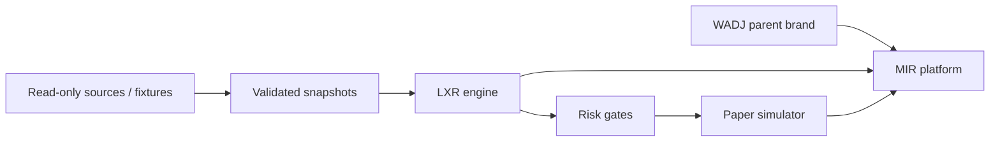

# Platform and engine boundaries

MIR owns the dashboard, watchlists, user settings, research history and presentation. LXR owns deterministic liquidity calculations and route assessments. Adapters own protocol-specific reads and normalization. Paper accounting consumes assessments and never signs or submits transactions. No execution adapter belongs in this starter.

## Snapshot contract

Each constant-product snapshot supplies: `chainId`, pool `address`, canonical `baseToken` and `quoteToken` addresses, `model: constant-product`, positive bigint `baseReserve` and `quoteReserve` in atomic units, integer `feeBps`, `blockNumber`, UTC `observedAtMs`, provenance `source`, and tri-state token-check evidence (only literal `true` passes the current gate).

Both route pools must be distinct addresses with the same chain and same base/quote token identities. Token symbols alone cannot identify a pair. The Ethereum Uniswap V2 adapter establishes token ordering and decimals, verifies factory membership and queries reserves at the same canonical finalized block hash. Independent chain-head/finality verification and risk evidence references remain required before live qualification. The LXR assessor itself still has fixture-oriented block/time gates; the live monitor does not feed its observations into route qualification.

AMM quote: `out = floor(input * (10000-feeBps) * reserveOut / (reserveIn*10000 + input*(10000-feeBps)))`.

The second leg uses the first leg's floored base output. Net quote = final quote output minus starting quote input minus quote-denominated gas estimate minus uncertainty buffer. Fees and price impact are already inside the AMM quotes; do not subtract fees twice. Both legs must remain below the configured reserve input cap. The cap is a research heuristic, not a maximum-loss guarantee.

## Read-only live adapter requirements

- The first adapter uses Ethereum mainnet and Uniswap V2. Additional chains/protocols require separate verified configurations and model support.
- Use public data reads only. Supply no signer or private-key interface. Never embed provider credentials in source or request them in chat.
- Rate-limit and retry reads with bounded backoff; mark unavailable sources explicitly and reject partial/inconsistent snapshots.
- Track head block and block hash; invalidate orphaned snapshots and dependent paper records after reorgs.
- Unknown token behavior, tax/rebasing tokens, unsupported curves or missing gas conversion evidence must keep a route unqualified.
- Preserve source, block, timestamps, cost assumptions and risk reasons with every result.

PaperLedger is process-local bookkeeping. It trusts the in-process assessor, checks arithmetic consistency and prevents duplicate IDs within one run. It is not a public API validation boundary. Production paper simulation needs durable unique snapshot/route IDs, replay protection across restarts, latency/fill/revert scenarios, updated reserves, and event-sourced reconciliation. Repeated simulations against unchanged reserves must not be presented as repeatable profit.
